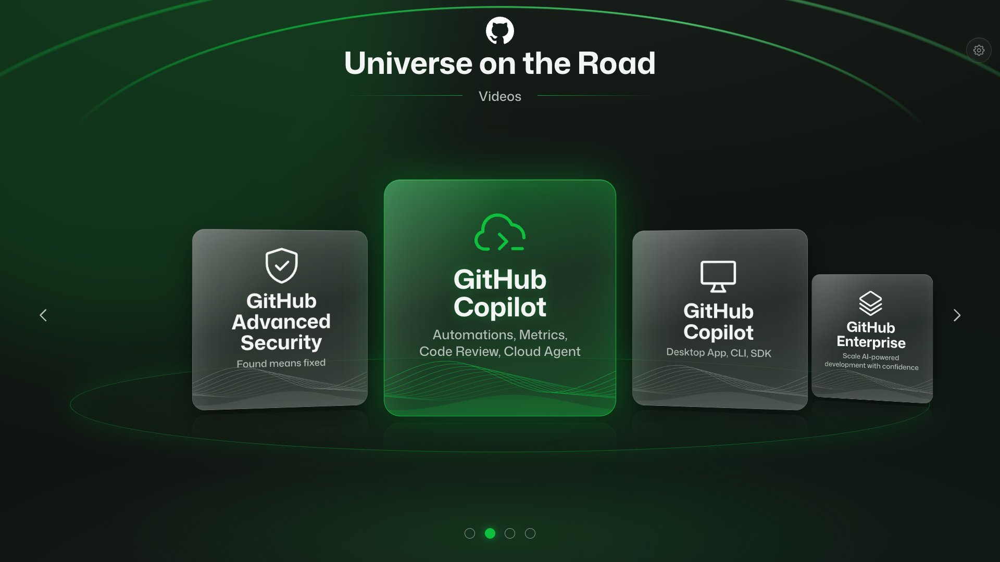
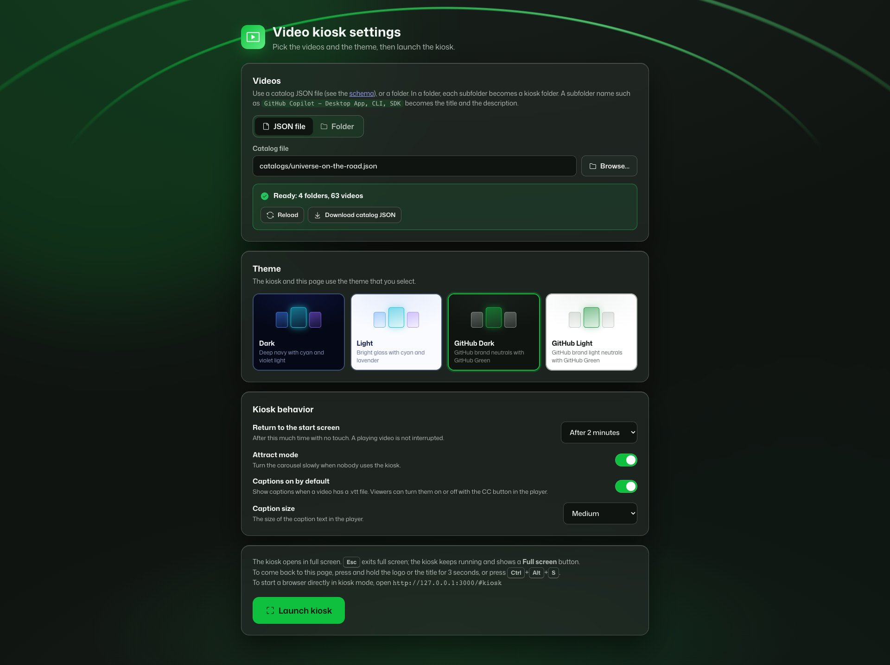
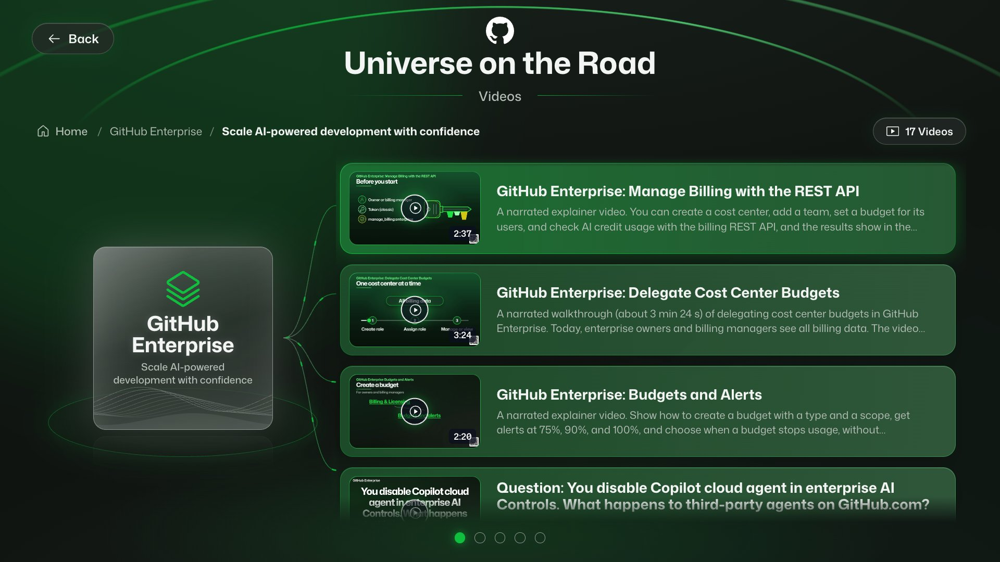
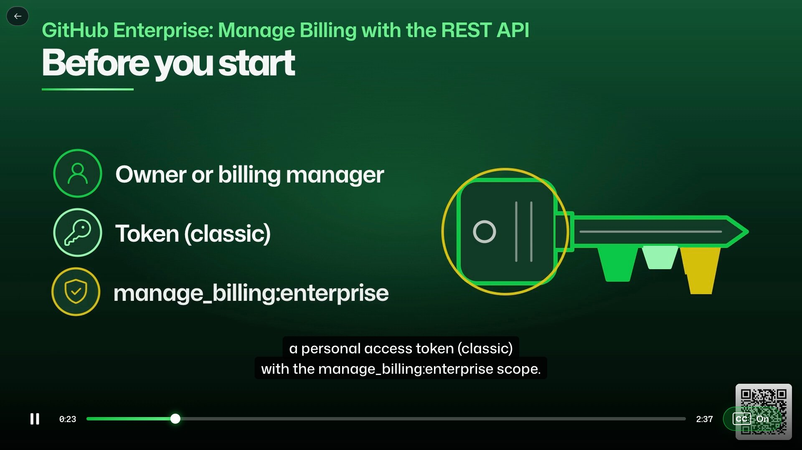

# Video kiosk

A self-service video kiosk for touch screens. Visitors pick a folder in a 3D carousel, pick
a video from a list, and watch it in full screen. When a video ends, the kiosk goes back to
the list at the same place.



- Node.js (Express) with plain HTML, CSS, and JavaScript. No build step.
- Themes: **Dark**, **Light**, **GitHub Dark**, **GitHub Light**, **VS Code Dark**, and **VS Code Light**.
- Closed captions from `.vtt` files, with a **CC On/Off** button in the player.
- Touch, mouse, and keyboard: tap or click any folder card, swipe or drag the carousel, or use the arrow keys.
- Works offline. Fonts, icons, and videos are local.

## Quick start

Requires:

- Node.js 24 or later.
- [ffmpeg](https://ffmpeg.org/) for thumbnails and video lengths (`brew install ffmpeg` or
  `winget install ffmpeg`).

1. Put your videos in `videos/`, one subfolder for each kiosk folder (the video files are
   not in this repository).
2. Install and start:
   ```bash
   npm install
   npm start
   ```
   The settings page opens at `http://127.0.0.1:3000/`. For a different port, use
   `PORT=3001 npm start` (macOS) or `$env:PORT=3001; npm start` (PowerShell). Use
   `npm start -- --no-open` to not open a browser.
3. On the settings page, pick a catalog JSON file or a folder, a theme, and the kiosk
   behavior (idle reset time, attract mode, loop video playback, mute videos, captions default,
   caption size).
4. Select **Launch kiosk**. It opens in full screen. **Esc** exits full screen only; a
   **Full screen** button then shows in the upper right. To return to the settings, select
   the gear on the home screen, press and hold the logo or the title for 3 seconds, or press
   **Ctrl+Alt+S**.



Settings are saved in `data/settings.json`. The browser also remembers the theme, so a
reload shows it at once.

## Using the kiosk

| Video list | Player |
|---|---|
|  |  |

- **Home:** tap any folder card to open it. Swipe or use the arrows and dots to turn the carousel.
  The gear in the top-right corner opens the settings.
- **Video list:** tap a video to play it. **Back** or **Home** returns to the carousel.
- **Player:** tap the video to show the controls, then tap to pause or play. The back arrow
  (top-left corner) is always visible; it shows **Back** when the video is paused. The speaker
  button turns sound on or off, and **CC** turns captions on or off; both choices carry to the
  next video. When a video ends, the list returns at the same place, with a check on that video.
- **Loop video playback:** when this setting is on, the videos in a folder play one after
  another. After the last video, the first plays again, until a viewer selects Back. Idle
  reset never stops a playing video, so the loop runs until someone stops it.
- **Mute videos:** when this setting is on, every video starts without sound. Turn captions on
  so viewers can still follow along.
- **Idle:** after the idle time, the kiosk returns to the start screen and resets captions and
  watched checks. It never stops a video that is playing. With attract mode on, the carousel
  turns slowly when nobody uses the kiosk.
- **Keyboard:** arrow keys turn the carousel, **Enter** opens or plays, **Backspace** goes back,
  and **Space** pauses.
- **macOS:** in full screen, the menu bar shows when the pointer moves to the top edge. This is
  normal macOS behavior, and the page stays in full screen. The kiosk hides the pointer after
  3 seconds.

## Start a browser in kiosk mode

Open `http://localhost:3000/#kiosk` to start the kiosk without the settings page. Start
the server first. The kiosk flags work only if the browser is not already open, so these
commands use a separate profile folder.

**macOS**

```bash
# Google Chrome
open -na "Google Chrome" --args --kiosk --user-data-dir=/tmp/kiosk-chrome http://localhost:3000/#kiosk
# Microsoft Edge
open -na "Microsoft Edge" --args --kiosk --user-data-dir=/tmp/kiosk-edge http://localhost:3000/#kiosk
```

**Windows (PowerShell)**

```powershell
# Google Chrome
Start-Process chrome -ArgumentList '--kiosk','--user-data-dir=C:\kiosk\chrome','http://localhost:3000/#kiosk'
# Microsoft Edge
Start-Process msedge -ArgumentList '--kiosk','--edge-kiosk-type=fullscreen','--no-first-run','--user-data-dir=C:\kiosk\edge','http://localhost:3000/#kiosk'
```

In browser kiosk mode, select the gear on the home screen (or hold the logo for 3 seconds) to open the settings. To close the browser, press
**Cmd+Q** (macOS) or **Alt+F4** (Windows).

## Catalog JSON

A catalog lists the folders and videos. Schema: [`schema/kiosk-catalog.schema.json`](schema/kiosk-catalog.schema.json).

Catalog file names end with the month and year they were made, as `<name>-<month>-<year>.json`
(for example, `universe-on-the-road-11-2026.json`), so that later versions can be told apart.

```json
{
  "$schema": "../schema/kiosk-catalog.schema.json",
  "title": "Universe on the Road",
  "subtitle": "Self-Serve Videos",
  "icon": "assets/GitHub_Invertocat_White.svg",
  "iconLight": "assets/GitHub_Invertocat_Black.svg",
  "folders": [
    {
      "title": "GitHub Copilot",
      "description": "Desktop App, CLI, SDK",
      "icon": "device-desktop",
      "videos": [
        {
          "title": "GitHub Copilot app: Computer Use",
          "description": "A short demo of Computer Use in the GitHub Copilot app.",
          "path": "../videos/GitHub Copilot - Desktop App, CLI, SDK/computer-use.mp4",
          "captions": "../videos/GitHub Copilot - Desktop App, CLI, SDK/computer-use.vtt"
        }
      ]
    }
  ]
}
```

| Property | Required | Notes |
|---|---|---|
| `title` | Yes | Main heading. |
| `subtitle` | No | Line below the title. |
| `icon` | Yes | A [Primer Octicon](https://primer.style/octicons) name, or a path or URL to an image. |
| `iconLight` | No | Icon for the light themes (for example, a black logo when `icon` is white). |
| `folders[].title`, `description` | Yes | `description` can be empty. |
| `folders[].icon` | No | Octicon name or image. Default: `file-directory`. Use the name without the size (`rocket`, not `rocket-24`). |
| `videos[].title`, `description`, `path` | Yes | `path` is a file path or an `http(s)` URL. |
| `videos[].captions` | No | A `.vtt` file. |
| `videos[].thumbnail`, `duration` | No | If you omit them, the server makes them with ffmpeg. |

Relative paths start from the folder that contains the catalog. Validate a catalog with:

```bash
npm run validate -- catalogs/universe-on-the-road-11-2026.json
```

Errors stop the kiosk from using a catalog. Warnings do not; for example, the kiosk hides a
video whose file is not found.

## Folder mode

Pick a folder instead of a JSON file. Folder mode uses `videos/` by default, and you can
pick any folder inside it (not outside it). Each subfolder becomes a kiosk folder. The name
`GitHub Copilot - Desktop App, CLI, SDK` becomes the title `GitHub Copilot` and the
description `Desktop App, CLI, SDK`. A `.vtt` file with the same name as a video adds
captions, and an optional `<video name>.json` file can set `title` and `description`. Videos
directly in the picked folder become one kiosk folder.

Without a `.json` file, the title comes from the file name: `copilot-cli-fleet.mp4` becomes
`Copilot CLI Fleet`. For question and quiz videos, the words before `question` are sort
prefixes and are removed: `github-gh-t-question-dependabot.mp4` becomes `Question: Dependabot`.

Select **Download catalog JSON** on the settings page to get a catalog that you can edit.

## Deploy to Azure

The kiosk can also run as a static site on [Azure Static Web Apps](https://learn.microsoft.com/azure/static-web-apps/),
with the videos in Azure Blob Storage. On a static site, the settings page saves the
settings in the browser. **Browse** lists the catalog JSON files in the build; there is no
folder mode. The live copy is at https://purple-sky-020d7461e.6.azurestaticapps.net/.

You need the [Azure CLI](https://learn.microsoft.com/cli/azure/install-azure-cli) (`az login`),
the [GitHub CLI](https://cli.github.com/) (`gh auth login`), ffmpeg, and push access to your
copy of this repository.

### 1. Create the Azure resources

Set names for your resources. The storage account name must be 3–24 lowercase letters and
numbers, and unique in Azure. On the Free plan, Static Web Apps is available in `westus2`,
`centralus`, `eastus2`, `westeurope`, and `eastasia`.

```bash
RG=my-video-kiosk          # resource group
LOCATION=westus2
STORAGE=myvideokiosk123    # storage account
CONTAINER=videos
SWA=my-video-kiosk         # Static Web App
```

Create the resource group, a storage account, and a container that anyone can read (the
kiosk plays the videos without a sign-in):

```bash
az group create -n $RG -l $LOCATION
az storage account create -n $STORAGE -g $RG -l $LOCATION --sku Standard_LRS --kind StorageV2 \
  --access-tier Hot --https-only true --min-tls-version TLS1_2 --allow-blob-public-access true
az storage container-rm create --storage-account $STORAGE -g $RG -n $CONTAINER --public-access blob
```

Set the two blob service settings that make the videos stream:

- **Default service version.** A browser does not send the `x-ms-version` header, so without
  a default, Blob Storage answers with a 2009 API version that does not return
  `Accept-Ranges: bytes`. Then the browser cannot fetch parts of a video to stream or seek.
- **CORS** that exposes the streaming headers. The browser also needs CORS for captions.

```bash
az storage account blob-service-properties update --account-name $STORAGE -g $RG \
  --default-service-version 2026-02-06
az storage account blob-service-properties cors-rule add --account-name $STORAGE -g $RG \
  --allowed-origins "*" --allowed-methods GET HEAD OPTIONS --allowed-headers "*" \
  --exposed-headers Accept-Ranges Content-Range Content-Length Content-Type ETag --max-age 3600
```

Give your account permission to upload (with Microsoft Entra ID, not account keys). The role
can take a few minutes to apply. Then create the Static Web App:

```bash
az role assignment create --role "Storage Blob Data Contributor" \
  --assignee-object-id "$(az ad signed-in-user show --query id -o tsv)" --assignee-principal-type User \
  --scope "$(az storage account show -n $STORAGE -g $RG --query id -o tsv)"
az staticwebapp create -n $SWA -g $RG -l $LOCATION --sku Free --query defaultHostname -o tsv
```

The last command shows the site's address.

### 2. Make a catalog that uses Blob Storage

Put the videos in `videos/` and make a catalog for them (see [Catalog JSON](#catalog-json)).
Then make a copy of it with Blob Storage URLs. The tool also makes a thumbnail for each video
(in `data/azure/thumbnails`) and adds each video's length. Each file keeps its path under
`videos/`:

```bash
npm run azure:catalog -- --catalog catalogs/universe-on-the-road-11-2026.json \
  --base-url https://$STORAGE.blob.core.windows.net/$CONTAINER \
  --out catalogs/universe-on-the-road-azure-11-2026.json
```

### 3. Upload the files

Upload each file type with its content type. `npm run azure:faststart` copies each MP4 whose
index is at the end of the file to `data/azure/faststart`, with the index at the start (no
re-encoding), so it starts playing at once. Upload those copies after the others, so they
replace them:

```bash
npm run azure:faststart
UPLOAD="--account-name $STORAGE -d $CONTAINER --auth-mode login --overwrite true --max-connections 8"
az storage blob upload-batch $UPLOAD -s videos --pattern "*/*.mp4" --content-type video/mp4
az storage blob upload-batch $UPLOAD -s videos --pattern "*/*.vtt" --content-type "text/vtt; charset=utf-8"
az storage blob upload-batch $UPLOAD -s data/azure/faststart --pattern "*/*.mp4" --content-type video/mp4
az storage blob upload-batch $UPLOAD -s data/azure/thumbnails --destination-path thumbnails \
  --content-type image/jpeg
```

For nested folders, add more patterns (for example, `"*/*/*.mp4"`).

### 4. Build and deploy the site

List the Azure catalogs in `static-site.json`. It also sets the site's default settings
(theme, idle time, loop playback, mute, captions); each browser can change them on the
settings page. After you replace files in Blob Storage, increase `mediaVersion`: the build
adds it to the media URLs, so browsers do not use copies that they stored before.

The GitHub Actions workflow
([`.github/workflows/deploy-static-web-app.yml`](.github/workflows/deploy-static-web-app.yml))
runs `npm run build:static` and deploys `dist/` on every push to `main`. Save the Static Web
App's deployment token as a repository secret, then push:

```bash
gh secret set AZURE_STATIC_WEB_APPS_API_TOKEN --body "$(az staticwebapp secrets list \
  -n $SWA -g $RG --query properties.apiKey -o tsv)"
git push
```

To deploy without GitHub Actions, run `npm run build:static`, then
`npx @azure/static-web-apps-cli deploy ./dist --env production --deployment-token <token>`.
To look at the site locally first, serve `dist/` with any static file server.

**Costs:** the Free plan of Static Web Apps costs nothing. Blob Storage costs about $0.02 per GB
a month to store, and about $0.08 per GB that viewers watch after the first 100 GB a month.

## Security

The server listens on `127.0.0.1` by default. The settings API accepts requests only from
the same computer, and it checks the `Host` header to block DNS rebinding. The media routes
serve only files that the loaded catalog names. If you set `HOST=0.0.0.0` to show the kiosk
on another device, the settings page still works only on the server computer.

## Project structure

```
server.js                    Express server and API
lib/                         Catalog validation, folder mode, ffmpeg media, settings, icons, QuickXorHash
public/                      Settings page and kiosk (HTML, CSS, JavaScript modules)
schema/                      Catalog JSON schema
tools/validate.js            Catalog validation CLI
tools/sharepoint-catalog.js  Builds a catalog from a SharePoint listing and the board
tools/azure-catalog.js       Makes a copy of a catalog with Blob Storage URLs and thumbnails
tools/build-static.js        Builds the static site in dist/
tools/faststart.js           Copies MP4s with the index moved to the start, for streaming
static-site.json             Catalogs and default settings for the static site
catalogs/                    Catalogs and logo assets
videos/                      Your video files (not in Git)
docs/images/                 README screenshots
```

The GitHub Invertocat files in `catalogs/assets/` come from the
[GitHub brand toolkit](https://brand.github.com/foundations/logo). Show the logo in one
solid color (white on dark, black on light), with no effects.
